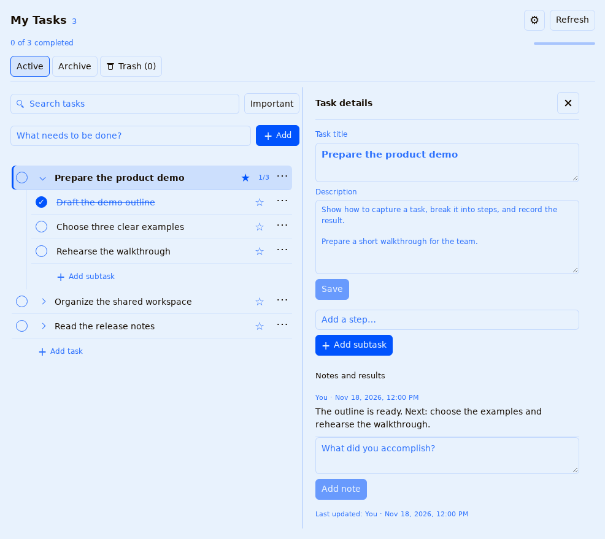
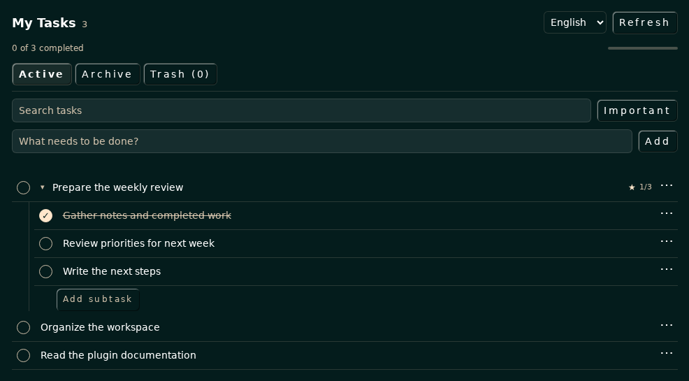
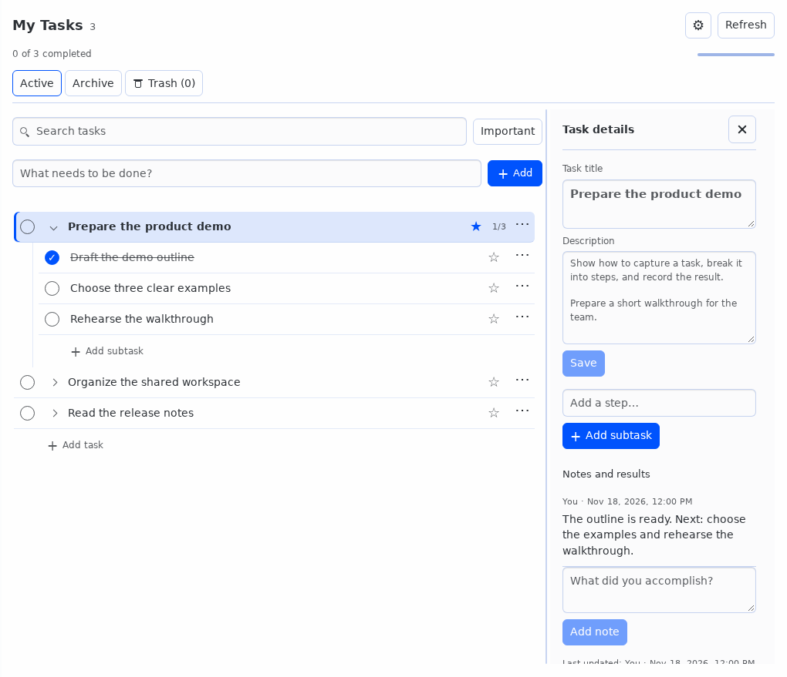
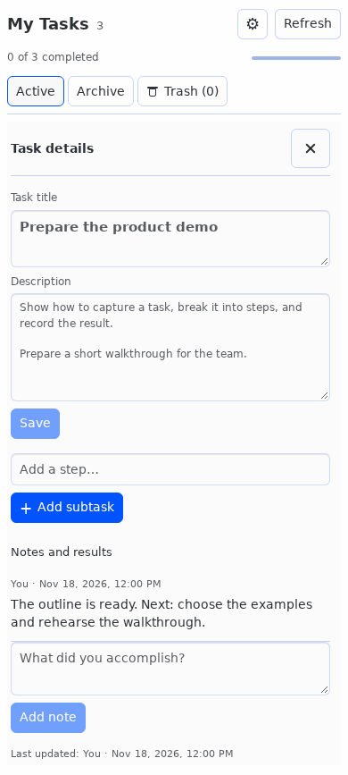

# Hermes Personal Task Manager

A personal checklist shared by **Hermes chat, Dashboard and Desktop/WebApp**.
Capture tasks with one level of subtasks, keep notes and confirmed results,
and return to the same list from either interface.

Version **0.2.4**. Requires **Hermes >=0.23.1**. English is the default UI
language; Russian is optional. This is a community project, not a NousResearch
maintained or verified plugin. Catalog submission is being prepared; it is not
currently available by catalog name.



## What it does

- Compact task rows with expandable subtasks, round checkboxes and step progress.
- Shared persistent storage, search, important tasks, descriptions and notes.
- Archive for completed groups; Trash with restoration and confirmed deletion.
- Native host controls and light/dark theme colors; responsive desktop/mobile UI.
- Revision checks, protected drafts and conflict warnings across both interfaces.

**You decide what changes.** Creating or checking a task only records a plan or
result. It never executes work, launches an agent, schedules a job or changes a
task to an autonomous "in progress" state.

Checking a parent completes its active children atomically and archives the
group. Completing the last child alone does not complete the parent. Reopening
a parent preserves child checkmarks; reopen the parent before reopening a child.
Completion timestamps are retained. There is no running timer/time tracker.

## Install from Git

Use the Git repository option in Hermes plugin management:

```text
https://github.com/RudiFreeman/hermes-personal-task-manager
```

Or use the CLI, replacing the placeholder with the exact commit being tested:

```sh
hermes plugins install RudiFreeman/hermes-personal-task-manager --ref FULL_COMMIT_SHA --enable
hermes plugins doctor personal-task-manager
```

Install the same package once: its backend provides the tools and Dashboard API,
and its Desktop half provides the WebApp page. Prebuilt JavaScript is included;
no npm build or Node installation is needed on the Hermes host. Root package.json
contains development dependencies; if asked to install Node dependencies for
normal use, they can be skipped. Python storage uses the standard library; the
Dashboard adapter uses Hermes's FastAPI and Pydantic 2 environment.

1. Select the intended Hermes profile and enable the plugin backend there.
2. Open **My Tasks** in Dashboard. For Desktop/WebApp, enable the package's Desktop
   half in **Capabilities / Plugins**, then open **My Tasks** in the sidebar.
3. Select the same profile in both interfaces to see the same tasks. Different
   profiles have separate task databases.
4. Reload Desktop plugins after an update. Start a new chat for updated tools.
   A Dashboard API route first installed on a running host may require a planned
   Dashboard restart; follow the host's installation guidance.

Do not expose the plugin API outside Hermes's authentication gate. Removing the
plugin's code does not constitute a task-data backup.

## Ask Hermes to help

The package registers exactly three tools:

| Tool | Purpose |
| --- | --- |
| personal_tasks_list | Read tasks, subtasks, comments, Trash and progress. |
| personal_tasks_add | Add a task with described subtasks, or a single child. |
| personal_tasks_update | Edit, comment, star, complete/reopen, trash, restore or purge. |

Example requests:

> Add a task to prepare my weekly review, with steps for reviewing notes and planning next week.

> Mark the weekly review completed. I reviewed the notes and saved next week's plan; record that result.

> Move that task to Trash. Keep it available for restoration.

Hermes acts only on an explicit user request. Before reconciling results it reads
the list, uses current revisions and supplies a result comment for completion.
Instructions prohibit inferring success from a plan or promise and treat task
text as data. Storage checks that evidence text exists; it cannot independently
verify the model's conclusion. Checking a parent through a requested tool call
uses the same atomic completion rule as the UI.

Tool lifecycle actions are separate from edits:
`action: "trash" | "restore" | "purge"`. Purge also requires `confirmed: true`
after explicit user confirmation. "Move to Trash" does not authorize purge.
Snapshots preserve non-trashed items in `tasks` and expose Trash in `trash`.

## Archive, Trash and synchronization

Both interfaces refresh after writes, on focus, and every three seconds while
visible. Dirty forms retain their original revision, text and focus. A conflict
leaves the draft intact: review/copy it, then explicitly discard/reload and retry.
Language changes do not discard drafts or silently accept a newer revision.

Trash preserves completion state, descriptions and comments. Restoring a group
does not restore a child previously trashed independently. Permanent deletion
removes the selected group and its comments/history after confirmation.





Screenshots use synthetic example data with API responses intercepted for
capture. They show the native Hermes host and actual plugin bundle, not user tasks.

## Data, security and disclosures

- **Storage:** SQLite tasks, revisions, notes and event history in the active
  profile's durable `plugin_data_dir('personal-task-manager')`, separate from
  source files. Only language and expansion preferences go in browser storage.
- **Network:** authenticated calls to the current Hermes instance's plugin API.
  No third-party runtime API, telemetry, external fonts or CDN. No credentials
  are stored or read by the plugin. No self-updater or remote executable loader.
- **Execution:** no shell calls, background workers, cron jobs, autonomous task
  execution or approval bypass. Browser polling stops when its view unloads.
- **Outside data:** normal operation reads only plugin source/data. The optional,
  non-secret `PTM_DATA_DIR` development override selects another storage directory;
  sharing it across profiles intentionally removes their storage separation.
- **Development only:** the opt-in loopback preview uses a separate local DB
  and an in-memory API token. Optional browser tests read operator-supplied
  authentication-state files; these are never committed or loaded by the plugin.

The schema-1 to schema-2 migration is transactional and preserves existing IDs,
content, revisions, notes and completion times. Back up a stopped database and
any WAL files before upgrading, and update all writers sharing that database
together. Older plugin versions refuse schema 2; schema downgrade is unsupported.
There is no export/import or automatic backup feature in this version.

## Compatibility and verification

The conservative compatibility floor is Hermes **0.23.1**, where both host
interfaces, model tools and the real API were tested. It is not a claim that
older releases work. The plugin requires host `ctx.register_tool`,
`plugins.plugin_storage.plugin_data_dir`, Dashboard SDK/manifest/API support,
and Desktop SDK routes, profile state, REST and lifecycle hooks.

See [release validation](docs/reports/V020_VALIDATION.md), the [initial catalog audit](docs/reports/CATALOG_COMPLIANCE.md)
and [catalog preparation results](docs/reports/CATALOG_PREPARATION.md) for tested versions,
commands and limits. Physical iOS/Safari, Firefox and messaging-channel workflows
are outside the browser checks so far. Human catalog review and the owner's
normal-installer acceptance are separate from automated validation.

See the [bug report](docs/reports/BUG_REPORT.md) and [installer checklist](docs/INSTALLER_ACCEPTANCE.md).

## Development

Python 3.10+ is sufficient for the optional local preview:

```sh
python backend/preview.py
```

Open http://127.0.0.1:8765. It binds loopback; development tasks are stored in
ignored `.local/tasks.db`. Do not use that database for tests.

Frontend development requires Node.js supported by the locked jsdom version
(`^22.22.2 || ^24.15.0 || >=26.0.0`):

```sh
npm ci
npm run build
npm test
python -m pytest -q --basetemp=.local/dev-tests
```

Edit `frontend/src/*`, especially `i18n.mjs` for translations, then rebuild.
`dashboard/dist/*` and `desktop/plugin.js` are generated, readable deliverables.
The two host adapters share `state.mjs`, `view.mjs` and `backend/store.py`; they use host
React. Only the standalone preview bundles React.

Tests use temporary databases. FastAPI/httpx tests are optional locally and must
also pass in the Hermes runtime. `python tests/test_browser.py --help` documents the optional
real-host regression with operator-supplied authentication files and an explicit
disposable profile. It creates and purges only its own UUID-named test group.

See [third-party notices](THIRD_PARTY_NOTICES.md) for the preview's bundled React
packages and [submission staging](catalog-submission/README.md) for the local
catalog/PR preparation workflow.

## License

Original project code and documentation are dual-licensed under
**MIT OR Apache-2.0**, at your option. See [LICENSE](LICENSE),
[MIT](LICENSE-MIT) and [Apache-2.0](LICENSE-APACHE) for the terms.
Third-party code retains its own licenses and notices.

## Official references

- [Plugin catalog submission](https://hermes-agent.nousresearch.com/docs/developer-guide/plugins/catalog-submission)
- [Public plugin API](https://hermes-agent.nousresearch.com/docs/developer-guide/plugins/public-api)
- [Extending Dashboard](https://hermes-agent.nousresearch.com/docs/user-guide/features/extending-the-dashboard)
